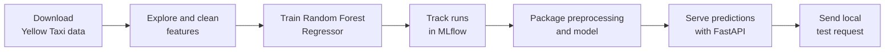

# Model Deployment Project

Use this repository as a **template** for your model deployment project. You will train a regression model that predicts the duration of NYC Yellow Taxi trips, track your experiments locally with MLflow, and serve predictions through a FastAPI app on your own machine. Create pull requests in your own copy even if you are working alone, and use them to track your progress.

## Learning Objectives

By the end of this repository, you should be able to:

- Build an end-to-end regression workflow for real-world taxi trip data.
- Separate exploration, preprocessing, training, and serving concerns into maintainable code.
- Track experiments locally with MLflow and compare model runs.
- Serve model predictions through a local API.

## Learning Path



| File / Folder | Description |
|---|---|
| [**Project Description**](project-description.md) | The assignment tasks, suggested workflow, repository layout, and stretch goals. |

### Additional Folders and Files

| File / Folder | Description |
|---|---|
| [**pyproject.toml**](pyproject.toml) | Project configuration and dependencies. |
| [**uv.lock**](uv.lock) | Dependency lock file. |

## Data cleaning

January 2025 yellow taxi file: 3,475,226 raw rows; 22 dropped for a pickup outside January 2025 and 124 dropped for a dropoff before the pickup, leaving 3,475,080 rows (see [docs/02-data-sources.md](docs/02-data-sources.md)).

## Tuning

The tuning rules are fixed in [docs/tuning-plan.md](docs/tuning-plan.md) and are not changed after results. Run `make tune` with the MLflow server up (`make mlflow-server`). The final metric and its caveats are in the Results and Caveats sections below.

If `make tune` is interrupted or fails, it leaves a partial `reports/results/trials.json`, and the next run refuses to start. To restart, delete `reports/results/trials.json`; earlier MLflow runs remain in the store, so ignore them or remove them by hand.

## Results

The test week (Jan 25 to 31, 2025) was read once, after the model was chosen: 791,334 trips after the scope filters. All numbers are minutes and come from [reports/results/metrics.json](reports/results/metrics.json); the trials come from [reports/results/trials.json](reports/results/trials.json).

| Model | RMSE | MAE | R2 |
|---|---|---|---|
| Champion | 4.109 | 2.741 | 0.816 |
| Baseline | 4.161 | 2.803 | 0.812 |
| Mean reference | 9.591 | 7.117 | -0.000 |

RMSE by segment (duration of the trip, and airport pickups against all others):

| Model | 1 to 10 min | 10 to 30 min | 30 to 60 min | Airport | Other |
|---|---|---|---|---|---|
| Champion | 2.101 | 3.850 | 10.161 | 6.389 | 3.936 |
| Baseline | 2.277 | 3.974 | 9.882 | 6.445 | 3.988 |
| Mean reference | 7.996 | 5.683 | 26.558 | 21.464 | 8.396 |

The champion's mean error (prediction minus actual) is -0.417 minutes. The champion is a random forest with max_depth 29, max_features sqrt, max_samples 0.9063233020424546, min_samples_leaf 15 and n_estimators 144, trained on the 300,000-trip sample. Its model file is 184,003,446 bytes (184.0 MB) and one prediction takes 3.2 ms (limits: 300 MB and 50 ms).

Promotion record: version 1 of taxi-duration, alias champion, SHA-256 54eaab2e6f20747ea71b3b388d4f1970c013e8ec8a542b71fad6d0275b2b40c1, registered and evaluated on 2026-11-18. The hash is pinned with `MODEL_SHA256` and the alias with `MODEL_URI` (see `.env.example`); the pin includes the version and moves with each promotion (ADR 8).

## Caveats

The champion's gain over the baseline is small: 1.2% lower RMSE on the test week and 1.6% lower mean RMSE in cross-validation. That is below the plan's 2% threshold, and no tuned model that passes the size limit reached it. The choice is driven by the size limit, not by the score: the baseline forest is 2,694,430,930 bytes (about 2.69 GB), far over the 300 MB limit, so it was never registered. The decision rule then took the tuned model with the best cross-validation RMSE among the 7 of 30 trials that pass both limits. The champion wins on every fold.

Larger forests were better in cross-validation but are over the size limit. The best trial that fails the limits (trial_26, about 2.25 GB) has a mean cross-validation RMSE of 4.170 against the champion's 4.243. It cannot be served under the plan, so it was not chosen.

The champion is worse than the baseline on long trips: RMSE on 30 to 60 minute trips is 10.16 against 9.88 for the baseline. It is better on the shorter segments.

It tends to underestimate: the mean error is -0.42 minutes (prediction minus actual), against -0.31 for the baseline.

Airport pickups (zones 1, 132 and 138) are harder: RMSE is 6.39 for the champion, against 3.94 for all other pickups.

The reported RMSE is optimistic for real requests (ADR 2). The model is trained on the trip distance measured by the taximeter and on the real dropoff zone. A real request carries a distance estimate and a stated destination, so the distance error of real requests is not in these numbers. A check that scores the test week with noisy distances is future work.

The scope rules of ADR 7 decide which trips are scored: 1 to 60 minutes, 0.1 to 100 miles, zone 264 removed, and an implied speed of 80 mph or less. The speed rule uses the trip duration, so it cannot be applied to API requests; the same rules are applied to the test week. Trips over 60 minutes are outside the scope and the model is not meant for them.

The data is one month (January 2025). Tuning and the baseline use a sample of 300,000 trips from Jan 1 to 24, not all training trips. Congestion pricing (started 2025-01-05) is not modelled. Seasonal effects, and anything after January 2025, are not covered.

MLflow can warn about the Python version when the registered model is loaded. The model file is stored in the safe skops format, and the `MLmodel` file written at registration names no Python version. The project runs on Python 3.13; load the model in the same Python and library versions as training.

## Setup

Use [uv](https://docs.astral.sh/uv/getting-started/installation/) 0.13.5 or newer
and Python 3.13.17 or a newer 3.13 patch release, as defined in
[`.python-version`](.python-version).

> [!NOTE]
> Throughout these steps, text in angle brackets like `<repo-name>` is a **placeholder**. Replace it, including the `< >` brackets, with your own value. For example, `cd <repo-name>` becomes `cd mle-model-deployment-project`.

### 1. Create the Repository from the Template

Click **Use this template** on GitHub.

When creating the repository:

- Set yourself as the **Owner**
- Choose a repository name
- Disable **Include all branches**
- Click **Create repository**

> [!IMPORTANT]
> If you are working in pairs or groups, only **one person** should complete this step.

---

### 2. Add Collaborators (Pairs/Groups Only)

If working with teammates:

1. Open the repository on GitHub
2. Go to **Settings → Collaborators**
3. Add your teammates as collaborators
4. Share the repository link with your team

Teammates should accept the invitation before continuing.

---

### 3. Clone the Repository

Copy the SSH URL from the **Code** button on GitHub, then run:

```bash
git clone <copied-ssh-url>
```

The copied SSH URL will look like `git@github.com:<your-username>/<repo-name>.git`.

---

### 4. Move into the Project Folder and Install Dependencies

This installs all dependencies and creates a virtual environment in `.venv/`.

```bash
cd <repo-name>
uv sync
```

---

### 5. Open the Repository in VS Code

> [!NOTE]
> Make sure you open VS Code from the project root so it automatically detects the environment created by `uv sync`.

Launch VS Code in the project root folder:

```bash
code .
```

If you create a notebook to explore the data, select the Python environment created by `uv sync` as the kernel.

## How to Use This Repo

1. Read the assignment brief in [project-description.md](project-description.md).
2. Download and inspect the January 2025 Yellow Taxi dataset.
3. Train a baseline `RandomForestRegressor` and track runs locally with MLflow.
4. Refactor preprocessing and training logic into reusable Python modules.
5. Build a local prediction API with FastAPI.
6. Send a test request to the API and document the outcome in your README or PR.

### Working Locally

Once you have implemented the project code, a typical local workflow looks like this:

1. Copy `.env.example` to `.env`. All hosts, ports and stores are read from it.
2. Start the MLflow server (sqlite store, artifacts in `mlartifacts/`, UI at http://127.0.0.1:5001):

   ```bash
   make mlflow-server
   ```

3. Train the model. Runs are logged through the server at `MLFLOW_TRACKING_URI`.
4. Run the API locally (http://127.0.0.1:8000):

   ```bash
   make api
   ```

5. Send a request to the API:

   ```bash
   curl -X POST http://127.0.0.1:8000/predict -H "Content-Type: application/json" -d @sample-request.json
   ```

The warehouse is a single DuckDB file with one writer at a time. Stop notebooks and the API before `make transform`. Notebooks open the warehouse read-only and close the connection in their last cell.

The `app/` package and `sample-request.json` are files you create during the project. Make the sample request match your `/predict` input schema before running the commands above.
